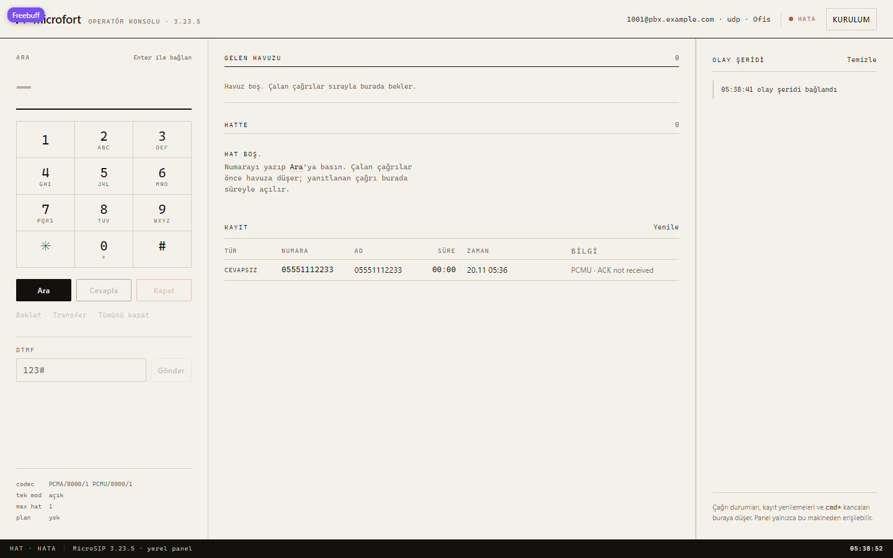

# microfortypescript

MicroSIP **3.23.5**'in mantık katmanının sıfırdan **TypeScript** portu. Ayrı bir
projedir: `loki-crm-next` içine gömülü değildir, çalışması için bir santral
(PBX) gerektirmez ve testleri tamamen kendi içinde (loopback SIP) döner.

[](https://github.com/eneshikmetkayim/microfortypescript/actions/workflows/ci.yml)

```
SIP katmanı            Uygulama katmanı                 Arayüzler
┌────────────────┐     ┌──────────────────────┐        ┌──────────────┐
│ mesaj/URI/SDP  │     │ microsip.ini         │        │ CLI          │
│ digest + MD5   │────▶│ URLMask + cmd* hooks │───────▶│ web paneli   │
│ transaction    │     │ dial plan + call log │        │ (SSE + JSON) │
│ REGISTER/çağrı │     │ Softphone            │        └──────────────┘
└────────────────┘     └──────────────────────┘
```

## Neden ayrı proje?

MicroSIP Windows'a bağlı bir MFC/pjproject uygulamasıdır (GPL v2). Doğrudan
Next.js içine taşınamaz. Bu repo, MicroSIP'in **davranışını** taşır:

- SIP protokolü (mesaj ayrıştırma, digest, transaction zamanlayıcıları,
  REGISTER, çağrı durum makinesi, SDP, DTMF, REFER)
- MicroSIP'e özgü iş mantığı (`microsip.ini`, `URLMask`, dial plan,
  `cmd*` kancaları, `call_log` şeması, kişiler)
- Bunları süren bir `Softphone` orkestratörü ve iki arayüz (CLI + web paneli)

## Gereksinimler

- Node.js **>= 24** (yerleşik TypeScript desteği ve `node:sqlite` için)
- Çalışma zamanı bağımlılığı yok; yalnızca `typescript` ve `@types/node` dev
  bağımlılığı vardır.

## Hızlı başlangıç

```bash
npm ci
npm run typecheck
npm test          # 95+ test, ~0.5 sn
npm run audit     # conformance raporu (audit-report.md)

node src/cli.ts init --path microsip.ini     # örnek ayar dosyası
node src/cli.ts config --ini microsip.ini
node src/cli.ts serve --ini microsip.ini     # http://127.0.0.1:4173
```

`serve` panelinde tuş takımı, aktif çağrılar, çağrı geçmişi ve hook günlüğü
vardır. Gerçek bir çağrı için `[Account1]` bölümünde çalışan bir SIP sunucusu
gerekir; testler için sunucu gerekmez.



Panel bilinçli olarak kartsız ve düz: kâğıt zemin, hairline çizgiler, tek sinyal
rengi (hata/kapat) ve mono rakamlar. Üç kolon geniş ekranda yan yana, dar
pencerede alt alta akar.

- **Kurulum** (sağ üst): sunucu, kullanıcı, parola, taşıma, görünen ad, dial plan
  ve eşzamanlı çağrı sayısını düzenler; kaydedince `microsip.ini` yerinde
  güncellenir ve bağlantı alanları değiştiyse hat yeniden bağlanır. Parola hiçbir
  yanıtta dönmez.
- **Gelen havuzu**: çalan çağrılar başlangıç sırasına göre bekler; her satırdan
  cevaplanır veya 486 ile reddedilir. Yanıtlanan çağrı “Hatte” bölümüne, süresiyle
  birlikte geçer.
- Panel yalnızca loopback'e bağlanır ve POST isteklerinde same-origin kontrolü
  yapar; kurulum uç noktası farklı origin'den 403 döner.

### CLI

| Komut | Açıklama |
| --- | --- |
| `version` | sürümler ve User-Agent |
| `config [--ini path] [--json]` | hesapları ve ayarları göster |
| `history [--db call_log.db] [--json]` | MicroSIP `call_log` veritabanını oku |
| `dial <numara> [--seconds 15]` | gerçek SIP çağrısı başlat, olayları yazdır |
| `serve [--port 4173]` | yerel web kontrol paneli |
| `init [--path microsip.ini]` | başlangıç ini dosyası üret |

## Kapsam ve doğrulama

Her port edilen modül, MicroSIP kaynağındaki karşılığı ve testiyle
[`docs/port-matrix.json`](docs/port-matrix.json) dosyasında eşlenir. Audit bu
matrisi çalışma ağacına karşı doğrular (kaynak var mı, test var mı, testler
geçiyor mu) ve rapor üretir.

Durum özeti (ayrıntı: [`docs/PARITY.md`](docs/PARITY.md)):

| Durum | Adet | Örnek |
| --- | --- | --- |
| `ported` | 15 | mesaj, URI, digest, REGISTER, transaction, çağrı, SDP, ini, URLMask, dial plan, call log, kişiler, Softphone |
| `adapted` | 3 | WSS taşıma, web paneli, SIP MESSAGE |
| `not-portable` | 4 | yerel ses/video, tray/hotkey, kayıt (pjmedia/LAME) |
| `pending` | 2 | presence/BLF, DNS SRV |

## Platform sınırları

Taşınamayanlar bilinçli olarak dışarıda: Win32/MFC arayüzü, pjmedia ses ve
video aygıtları, sistem tepsisi/hotkey, LAME mp3 kayıt. Ses yolu için planlanan
yön WebRTC'dir; sunucu tarafı kayıt santralin işidir. Bu sınırlar test edilmiş
gibi gösterilmez, matriste `not-portable` olarak işaretlidir.

## GitHub Actions

`.github/workflows/ci.yml` üç iş çalıştırır:

1. **test** — Ubuntu + Windows, Node 24: `typecheck`, tüm testler (JUnit
   artifact), CLI smoke testi
2. **conformance** — `npm run audit`, matris + test kanıtı, `audit-report.md`
   artifact'ı ve iş özeti
3. **web** — paneli başlatıp `/api/status` ve HTML yanıtını doğrular

Depoyu bağlama adımları: [`docs/GITHUB.md`](docs/GITHUB.md).

## Lisans

MicroSIP GPL v2'dir; bu port onun türevi bir çalışmadır ve **GPL-2.0-or-later**
altında dağıtılır. Ayrıntı: [`LICENSE`](LICENSE).
